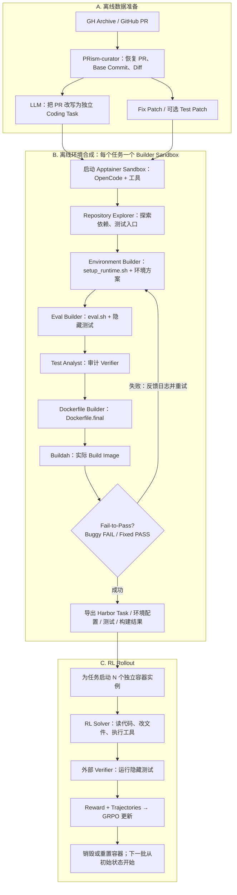
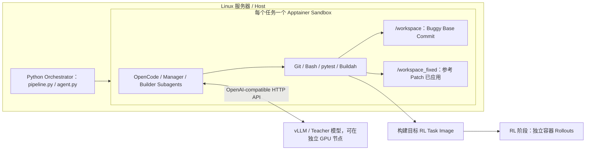

# Coding Agent RL：PRism 环境构建速查

> **一句话记忆**：真实 GitHub PR → 任务指令与参考 Patch → Builder Sandbox 内自动生成运行环境和 Verifier → 实际构建、Fail-to-Pass 验证 → 导出 Harbor Task → RL 时从干净环境启动各个 Rollout、运行隐藏测试给 Reward。
>
> **论文**：[K2-Horizon（arXiv:2611.21003）](https://arxiv.org/abs/2611.21003) · [PDF](https://arxiv.org/pdf/2611.21003) · [AlphaXiv](https://www.alphaxiv.org/pdf/2611.21003)  
> **代码总入口**：[PRism-synthesis](https://github.com/ifm-ai/PRism-synthesis) · [pr_task_synthesis](https://github.com/ifm-ai/PRism-synthesis/tree/main/pr_task_synthesis)  
> **论文定位**：§5 PRism 数据构建（重点 §5.1–5.6，尤其 §5.6 RL Task Synthesis）；§6 RL Infrastructure / Algorithm。

## 1. 全流程（可直接在 GitHub 中渲染的 Mermaid）



> **特别注意**：PRism 的离线合成阶段已经**真正构建并验证过** Image（Buildah + Apptainer），不是只写 Dockerfile。GitHub 公布的样例主要是文本产物，重新拿到本地后仍可能需要重建/缓存 Image。RL Rollout 通常不重新 Build，而是启动已有镜像对应的干净容器。 

## 2. 术语和常见误区

| 名称 / 问题 | 正确理解 |
| --- | --- |
| **Dockerfile** | 文本版的镜像构建说明书：选基础镜像、安装依赖、设置工作目录等。 |
| **Image** | Dockerfile 构建出的可重复使用的镜像模板，通常包含代码及依赖。 |
| **Container** | 从 Image 创建的运行实例；一个 Image 可以起多个相互隔离的 Rollout Container。 |
| **Docker / Buildah / Apptainer** | 不同容器工具：Docker 能构建/运行；Buildah 用于构建 OCI/Docker 镜像；Apptainer 在 PRism 用于隔离 Builder 及验证镜像。 |
| **一个任务 = 一个 Dockerfile / Image？** | PRism 为每个 PR 合成任务专属环境定义；不代表所有系统必须一任务一镜像。相同依赖可复用基础镜像或镜像层。 |
| **一个 Rollout = 一个 Image？** | **不是**。一般一个任务的 Image 可启动 N 个独立 Container。 |
| **每个容器下载完整 Linux / Windows？** | **不需要**。Linux 容器共享主机 Linux 内核，Image 包含 Linux 用户空间和应用依赖；Mac/Windows 上的 Linux Docker 通常借助 Linux VM。 |
| **Windows-only 工程？** | PRism 的 Linux 构建流程不支持需要 WinAPI、UWP、WinRT、MSVC Windows 专用构建/运行的路径，会标记 `infrastructure_limited` 并停下；跨平台 .NET 不必然被拒绝。 |
| **Patch** | 改动差异，而不是完整仓库。`fix.patch`=参考修复；`test.patch`=测试改动；RL Agent 生成的补丁则是其自己的修改。 |
| **pytest** | Python 自动执行测试的工具，不会自动证明所有代码正确。 |
| **eval.sh / Verifier** | `eval.sh` 激活环境、调用真正测试框架、收集退出码；外部评估系统用结果产生 Reward。 |
| **Fail-to-Pass** | 对原始 Buggy Code 必须失败，对应用参考 Patch 的 Fixed Code 必须成功；只能证明基本区分能力，还需要防 Reward Hacking 审计。 |

## 3. Builder Agent 到底运行在哪里？



- **主机**：运行 Python 调度器、启动/回收 Sandbox、收集产物。
- **Builder Sandbox**：是真实的可写 Linux 隔离环境，**不是模拟器**；一个 PR 任务通常一个 Sandbox，同任务的多个 Subagent 在其中协作。
- **模型服务**：OpenCode 通过 API 调用 Qwen3.5 等 Teacher；**LLM 的推理进程不必在 Sandbox 中**，可以在其他 GPU 节点。
- **Builder Sandbox ≠ RL Task 容器**：前者是数据生产车间，后者是给 RL Solver 做任务的运行实例；可以出现容器内再用 Buildah 构建容器镜像的情形。

源码：[Builder 的 Apptainer 配置（`pipeline.py`）](https://github.com/ifm-ai/PRism-synthesis/blob/main/pr_task_synthesis/pipeline.py) · [Apptainer 执行器](https://github.com/ifm-ai/PRism-synthesis/blob/main/agentdist/executors/apptainer.py) · [Buildah 镜像构建（`agent.py`）](https://github.com/ifm-ai/PRism-synthesis/blob/main/pr_task_synthesis/agent.py)。

## 4. 关键目录：截图中的六个文件代表什么？

```text
pr_task_synthesis/data/final/<task_id>/
├── environment/                       # 你的截图：只含环境相关产物
│   ├── exploration_report.json        # Repository Explorer：语言、依赖、测试入口
│   ├── environment_request.json       # Environment Builder：环境配置与激活约定
│   ├── repo_setup.sh                  # Pipeline 提供：clone 指定 Base Commit
│   ├── setup_runtime.sh               # Environment Builder：安装项目依赖
│   ├── container_build_plan.json      # Dockerfile Builder：结构化构建计划
│   └── Dockerfile.final               # Dockerfile Builder：正式镜像构建说明
├── status/
│   ├── environment_builder.json       # 本阶段状态：安装成功？pytest 可用？
│   ├── repository_explorer.json
│   ├── eval_builder.json
│   ├── test_analyst.json
│   ├── dockerfile_builder.json
│   └── build_validator.json
├── evaluation/                        # 真正的 Verifier，不在上面的 environment/
│   ├── eval.sh
│   ├── test.patch                     # 可能存在
│   └── tests/                         # 隐藏测试
├── harbor_task/                       # 导出的 RL Task Bundle
│   ├── task.toml
│   ├── instruction.md
│   ├── environment/
│   └── tests/
├── verify_logs/
├── analysis_report/
└── ...
```

> `environment_request.json` 是 **Specification（想怎么装）**；`status/environment_builder.json` 是 **Status（实际上装成功了吗）**。下游 Builder/Eval Agent 读前者；Manager 用后者做流程控制。`container_build_plan.json` 是便于机器读取的构建计划，真正的镜像由 `Dockerfile.final` 构建。

### 一个真实案例：`ArneBinder/pytorch-ie` PR #408

[真实目录](https://github.com/ifm-ai/PRism-synthesis/tree/main/pr_task_synthesis/data/final/ArneBinder_pytorch-ie_pr408) · [环境配置](https://github.com/ifm-ai/PRism-synthesis/blob/main/pr_task_synthesis/data/final/ArneBinder_pytorch-ie_pr408/environment/environment_request.json) · [执行状态](https://github.com/ifm-ai/PRism-synthesis/blob/main/pr_task_synthesis/data/final/ArneBinder_pytorch-ie_pr408/status/environment_builder.json)

```json
// 节选：environment_request.json（示意精简，不是可直接解析的完整原文件）
{
  "base_image_candidate": "python:3.11-slim",
  "system_packages": ["git", "curl", "build-essential", "python3-dev"],
  "setup_runtime_commands": [
    "cd /workspace && poetry env use python3.11",
    "cd /workspace && poetry install --with dev --no-interaction"
  ],
  "activation_command": "source $(poetry env info --path)/bin/activate",
  "detected_test_command": "poetry run pytest tests/core/test_document.py::test_annotation_sort"
}
```

```json
// 节选：status/environment_builder.json（示意精简）
{
  "status": "complete",
  "runtime_created": true,
  "base_deps_installed": true,
  "test_runner_reachable": true,
  "setup_runtime_exit_code": 0,
  "infrastructure_limited": false
}
```

## 5. 环境安装脚本 `setup_runtime.sh` 为什么会运行两次？

| 阶段 | 执行地点 | 作用 |
| --- | --- | --- |
| ① 合成时探测 | Builder 的 Apptainer Sandbox 内 | Builder 用 Bash 执行，检查依赖安装、测试运行器可用；失败读日志并修改脚本（Prompt 允许最多重试两次）。 |
| ② 正式镜像构建 | Builder Sandbox 内由 Buildah 构建的目标 Image | Dockerfile 中 `RUN setup_runtime.sh` 将依赖安装进目标镜像层。 |
| ③ RL Rollout | 从已有 Image 启动容器 | **通常不重新安装**；只激活已准备好的运行时，执行任务并验证。 |

**易错细节**：官方 Prompt 要求在临时 Probe 目录中测试安装；但具体生成的 `setup_runtime.sh` 可能仍写死 `/workspace`。不要只看 Prompt 声称隔离成功，应核实实际执行脚本、日志与目录写入。

示例 Dockerfile（经省略）：

```dockerfile
FROM python:3.11-slim
RUN apt-get update && apt-get install -y git curl build-essential python3-dev
RUN pip install poetry
COPY repo_setup.sh /opt/benchmark/repo_setup.sh
RUN /opt/benchmark/repo_setup.sh
COPY setup_runtime.sh /opt/benchmark/setup_runtime.sh
RUN /opt/benchmark/setup_runtime.sh
WORKDIR /workspace
```

真实 [Dockerfile.final](https://github.com/ifm-ai/PRism-synthesis/blob/main/pr_task_synthesis/data/final/ArneBinder_pytorch-ie_pr408/environment/Dockerfile.final) · [setup_runtime.sh](https://github.com/ifm-ai/PRism-synthesis/blob/main/pr_task_synthesis/data/final/ArneBinder_pytorch-ie_pr408/environment/setup_runtime.sh)。

## 6. 如何自动生成可靠的 Verifier？

1. **输入**：`issue.md`、真实 `fix.patch`、可选 `test.patch`，以及 Buggy / Fixed 两份代码。
2. **Eval Builder**：生成或选取相关隐藏测试（Python 用 pytest，其他语言用对应测试框架），写 `eval.sh`。
3. **禁止作弊**：不能通过 `git diff`、检查源码字符串或某个文件存在来直接决定奖励；真正执行代码路径。
4. **Test Analyst / 外层验证**：同一 `eval.sh` 对 Buggy Code **失败**、对 Reference-Fixed Code **成功**；还要检查测试覆盖、环境与任务对齐。
5. **生成正式 RL Task**：隐藏测试不应作为可读文件暴露给 RL Solver，`fix.patch` 更不能泄露。

真实测试入口（节选，省略细节）：

```bash
#!/usr/bin/env bash
set -uo pipefail
SCRIPT_DIR="$(cd "$(dirname "$0")" && pwd)"
cd /workspace
source "$(poetry env info --path)/bin/activate"
echo ">>>>> Start Test Output"
poetry run pytest "$SCRIPT_DIR/tests/test_annotation_sort.py" -v
RC=$?
echo ">>>>> End Test Output"
echo "OPENENV_EXIT_CODE=$RC"
exit "$RC"
```

**Reward 最简形式**：`R = 1` 若隐藏测试全部通过，否则 `R = 0`；真实 RL 框架可设计额外奖惩。`Fail-to-Pass` 只是基本有效性条件，不保证完备覆盖。

真实 [eval.sh](https://github.com/ifm-ai/PRism-synthesis/blob/main/pr_task_synthesis/data/final/ArneBinder_pytorch-ie_pr408/evaluation/eval.sh) · [隐藏测试](https://github.com/ifm-ai/PRism-synthesis/blob/main/pr_task_synthesis/data/final/ArneBinder_pytorch-ie_pr408/evaluation/tests/test_annotation_sort.py)。

## 7. 多 Agent 怎样协作：不是一次模型调用生成六个文件

| Agent / 代码模块 | 主要产物或任务 | Prompt / 源码 |
| --- | --- | --- |
| **Manager** | 依次调度 Subagents，读状态，反馈错误并迭代 | [openenv-manager.md](https://github.com/ifm-ai/PRism-synthesis/blob/main/pr_task_synthesis/prompts/agents/openenv-manager.md) |
| **Repository Explorer** | `exploration_report.json` | [openenv-repository-explorer.md](https://github.com/ifm-ai/PRism-synthesis/blob/main/pr_task_synthesis/prompts/agents/openenv-repository-explorer.md) |
| **Environment Builder** | `environment_request.json`, `setup_runtime.sh`, `status/environment_builder.json` | [openenv-environment-builder.md](https://github.com/ifm-ai/PRism-synthesis/blob/main/pr_task_synthesis/prompts/agents/openenv-environment-builder.md) |
| **Eval Builder** | `eval.sh`, `tests/`, 可选 `test.patch` | [openenv-eval-builder.md](https://github.com/ifm-ai/PRism-synthesis/blob/main/pr_task_synthesis/prompts/agents/openenv-eval-builder.md) |
| **Test Analyst** | 审计 Verifier、Fail-to-Pass、防 Reward Hacking | [openenv-test-analyst.md](https://github.com/ifm-ai/PRism-synthesis/blob/main/pr_task_synthesis/prompts/agents/openenv-test-analyst.md) |
| **Dockerfile Builder** | `Dockerfile.final`, `container_build_plan.json` | [openenv-dockerfile-builder.md](https://github.com/ifm-ai/PRism-synthesis/blob/main/pr_task_synthesis/prompts/agents/openenv-dockerfile-builder.md) |
| **Build Validator / 外层 Python** | Buildah 构建与检查、失败反馈和导出 | [agent.py](https://github.com/ifm-ai/PRism-synthesis/blob/main/pr_task_synthesis/agent.py) |

**注意**：`repo_setup.sh` 不是上述 Environment Builder 独立凭空生成的；`pipeline.py` 会根据仓库 URL 和 Base Commit 创建克隆脚本，之后在导出产物中保留相应文件。多个 Subagents 在**同一任务的 Builder Sandbox** 中工作，但由不同 Prompt 控制。外层 Python 在最多 16 次外层轮次中执行构建、验证与反馈。

## 8. 最小输入与复现启动命令

环境合成的任务记录至少需要：

```json
{
  "task_id": "example_task",
  "repo": "https://github.com/owner/repo.git",
  "base_commit": "真实的修改前 commit SHA",
  "issue": "脱离 PR 上下文的独立开发任务描述",
  "fix_patch": "真实 PR 的修复 diff"
}
```

`test_patch` 是可选的。`base_commit` 和 `fix_patch` 用来构造 Buggy / Fixed 代码，**真实 RL Solver 只能接触初始 Buggy Code 与任务指令**。

PRism 提供的示例执行入口（需 Linux、容器工具、模型服务、权限支持）：

```bash
# 先在 pr_task_synthesis/ 中准备 Builder Sandbox 基础镜像
# 这是 Builder 的运行环境，不是最终任务镜像
docker build -t swe-env-builder .
apptainer build sandbox.sif docker-daemon://swe-env-builder:latest

export MODEL_BASE_URL=http://<vllm-host>:8000/v1
export MODEL=Qwen/Qwen3.5-397B-A17B-FP8
export MODEL_API_KEY=EMPTY

python pipeline.py --tasks data/input.jsonl --output-dir runs --concurrent 4
```

**提示**：这里的 `MODEL_BASE_URL` 必须在 Sandbox 内可访问；`localhost` 不一定是宿主机。嵌套 Buildah / Apptainer 还需要 Linux User Namespace / 合适的权限配置。Mac 上不建议直接照搬全部生产流程。

## 9. 论文与开源代码（全部保存）

### 论文与导航
- **K2-Horizon**：[arXiv 摘要](https://arxiv.org/abs/2611.21003) · [PDF](https://arxiv.org/pdf/2611.21003) · [AlphaXiv](https://www.alphaxiv.org/pdf/2611.21003)
- **数据工具总入口**：[ifm-ai/DATA_NAVIGATOR](https://github.com/ifm-ai/DATA_NAVIGATOR)
- **PRism 生成代码总仓库**：[ifm-ai/PRism-synthesis](https://github.com/ifm-ai/PRism-synthesis)

### 从 GitHub PR 到 Coding Task
- [PRism-curator](https://github.com/ifm-ai/PRism-curator)：GH Archive 事件采集、PR 聚合、Git Diff / Base Code 提取；尤其 [stage3_code_enhanced.py](https://github.com/ifm-ai/PRism-curator/blob/master/stage3_code_enhanced.py)
- [PRism-annotator](https://github.com/ifm-ai/PRism-annotator)：PR 类别、复杂度标注；[prompt_template.txt](https://github.com/ifm-ai/PRism-annotator/blob/master/prompt_template.txt)
- [PR → Coding Task Prompt](https://github.com/ifm-ai/PRism-synthesis/blob/main/pr_tasks/prompt.py) · [vLLM 调用](https://github.com/ifm-ai/PRism-synthesis/blob/main/pr_tasks/generate.py)
- [PR → Developer Thoughts Prompt](https://github.com/ifm-ai/PRism-synthesis/blob/main/pr_thoughts/prompt.py)
- [长程 PR Chain Task/Handoff Prompt 与 API](https://github.com/ifm-ai/PRism-synthesis/blob/main/pr_chain_agent_datagen/synthesis.py)

### Coding RL Environment：优先阅读
- **[pr_task_synthesis/README.md](https://github.com/ifm-ai/PRism-synthesis/blob/main/pr_task_synthesis/README.md)**：完整流程与运行要求
- **[pipeline.py](https://github.com/ifm-ai/PRism-synthesis/blob/main/pr_task_synthesis/pipeline.py)**：输入任务、准备仓库、Apptainer Sandbox 与 OpenCode 配置
- **[agent.py](https://github.com/ifm-ai/PRism-synthesis/blob/main/pr_task_synthesis/agent.py)**：外层循环、Buildah 构建、Verifier 检验与反馈
- **[Prompts/agents](https://github.com/ifm-ai/PRism-synthesis/tree/main/pr_task_synthesis/prompts/agents)**：多个 Builder Subagent 的真实 Prompt
- **[Apptainer Executor](https://github.com/ifm-ai/PRism-synthesis/blob/main/agentdist/executors/apptainer.py)**：Sandbox 的创建、命令执行
- **[真实任务示例：pytorch-ie PR #408](https://github.com/ifm-ai/PRism-synthesis/tree/main/pr_task_synthesis/data/final/ArneBinder_pytorch-ie_pr408)**：完整 JSON、Dockerfile、测试和 Harbor Task

### 快速复习（30 秒）

1. **PR 数据**产生 `repo + base_commit + issue + fix.patch`。
2. **主机 Orchestrator** 启动每任务的 **Builder Apptainer Sandbox**；OpenCode 在里面执行命令，Teacher LLM 通过 API 推理。
3. 多个 **Builder Subagents** 先探测依赖与测试，再生成 `setup_runtime.sh`、`Dockerfile.final`、`eval.sh` 和隐藏测试。
4. **合成阶段就构建并验证 Image**：Buggy FAIL、Fixed PASS，通过才导出 RL Task；构建失败会反馈修复。
5. **RL 阶段**复用/重建缓存的 Image，为 N 个 Rollout 启动干净 Container；只给 Solver 任务和 Buggy Code，不给 `fix.patch` 或隐藏答案；Verifier 给 Reward。

**终极公式：`PR → Builder Sandbox → Dockerfile + Tests → Build Image + Fail-to-Pass → Harbor Task → Rollout Containers → Reward → RL`**
