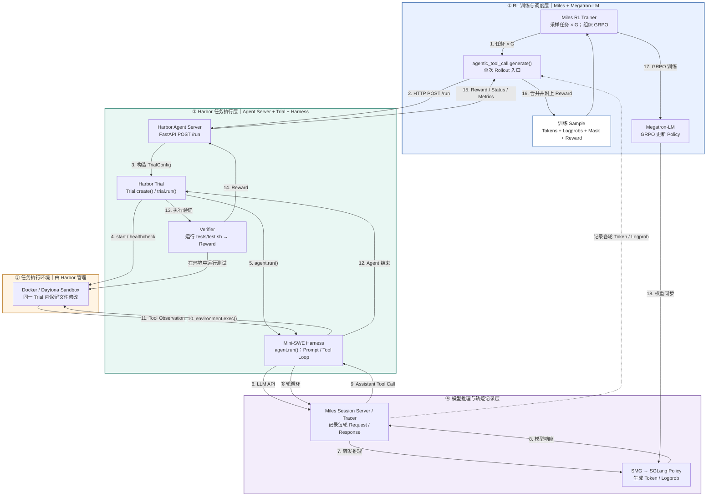

# RL360 × Harbor：Agentic RL 架构与调用流程

> **一句话总览：** Miles 负责采样、记录训练轨迹和优化策略；Harbor 负责加载任务、创建环境、运行 Harness 和 Verifier；Harness 在同一个 Sandbox 上循环调用模型与工具；Miles Session Server 记录模型实际生成的 Token/Logprob，最后与 Harbor Reward 汇合用于 GRPO。
>
> 基于 [IFM / RL360](https://github.com/ifm-ai/RL360) 公开代码；重点是 **Coding Agent 的 Harbor 接入方式**，不是声称所有 K2-Horizon 任务都采用相同 Harness。代码示例分为 **真实接口** 与 **教学伪代码**，不能把后者当成可直接启动完整分布式训练的程序。

## 1. 全局架构图（按负责组件分框）

> GitHub、VS Code 的 Mermaid 预览以及 Obsidian 均可渲染此图。**实线**表示执行请求/数据流，**虚线**表示额外的 Token/Logprob 记录通道。



**两条不同的返回路径（最容易忽略）：**

- **Harbor → Miles：** `reward`、`exit_status`、`eval_report`、`agent_metrics`。Harbor **不负责**计算训练 Token 的策略梯度。
- **Session Tracer → Miles：** `tokens`、`rollout_log_probs`、`loss_mask`、`response_length` 等。模型请求必须经过 Tracer，才会完整收集到训练轨迹。

## 2. 四层分别做什么

| 层 | 关键组件 | 做什么 | 不做什么 |
|---|---|---|---|
| RL 调度/训练 | Miles + Megatron-LM | 任务采样、组内 Rollout、GRPO、训练与权重同步 | 不直接安装任务依赖或执行 pytest |
| Harbor | Agent Server + Trial + Verifier | 加载 `task.toml`、启动环境、选择 Harness、评分 | 不执行梯度更新 |
| Harness | `mini-swe-agent-external` | 构建 Prompt、调用 LLM、解析工具、拼接历史、判定结束 | 不构建策略梯度训练批次 |
| Sandbox | Docker / Daytona | 保存本次任务的代码与文件状态、执行 Shell | 不决定 Agent 的策略 |
| 推理/记录 | Session Server + SMG + SGLang | 生成模型输出，记录可训练 Token/Logprob | 不执行环境的 Verifier |

> 这里的 **`mini-swe-agent-external` 是 Harbor 内部实现的 Harness**，不是“在 Harbor 外面再启动 OpenCode”。它的默认原生工具是 `bash`；启用 `web` 选项时才另提供搜索与网页抓取工具。

## 3. 一个任务如何被执行：关键源码调用链

### 3.1 Miles → Harbor Agent Server

[源码：`swe_agent_function.py`](https://github.com/ifm-ai/RL360/blob/main/src/agent360/harbor/miles/swe_agent_function.py)

```python
# 教学简化：真实代码使用异步 HTTP client、重试和超时控制
request = {
    "instance_id": "task-001",   # Harbor Task 目录名
    "sample_idx": 0,             # 当前任务第几条采样轨迹
    "agent_name": "mini-swe-agent-external",
    "model": "openai/model",
    "base_url": session_url,    # 关键：Miles Session Server，而非直接 SGLang
    "sampling_params": {"temperature": 1.0, "top_p": 1.0, "max_tokens": 8192},
    "llm_timeout_sec": 600,
}
result = await post_json("http://harbor-server:11000/run", request)
# result ≈ {"reward": 1.0, "exit_status": "Submitted", ...}
```

**入口：** `agentic_tool_call.generate()` → `swe_agent_function.run()` → HTTP `POST /run`。

### 3.2 Harbor Server → Harbor Trial（真实调用接口）

[源码：`harbor_server.py`](https://github.com/ifm-ai/RL360/blob/main/src/agent360/harbor/miles/harbor_server.py) · [Harbor `TrialConfig`](https://github.com/ifm-ai/RL360/blob/main/components/harbor/src/harbor/models/trial/config.py)

```python
# 与 RL360 内置 Harbor API 一致的核心调用形式；省略参数生成与容错
from harbor.models.trial.config import TrialConfig, TaskConfig, AgentConfig, EnvironmentConfig
from harbor.trial.trial import Trial

config = TrialConfig(
    task=TaskConfig(path=task_path),
    agent=AgentConfig(
        name="mini-swe-agent-external",
        model_name="openai/model",
        kwargs=agent_kwargs,   # 包含指向 Session Server 的 model_kwargs
    ),
    environment=EnvironmentConfig(type="daytona", delete=True),
)
trial = await Trial.create(config=config)
result = await trial.run()
reward = result.verifier_result.rewards.get("reward", 0.0)
```

**`Trial.create()`** 负责实例化任务、Agent 和 Environment；**`Trial.run()`** 才实际启动环境并执行 Agent 与测试。

### 3.3 `Trial.run()` 内部

[源码：`trial.py`](https://github.com/ifm-ai/RL360/blob/main/components/harbor/src/harbor/trial/trial.py)

```python
# 伪代码：真实方法还处理 healthcheck / timeout / 异常 / 日志 / 清理
async def trial_run():
    await environment.start()
    await agent.setup(environment)
    await agent.run(
        instruction=task.instruction,
        environment=environment,
        context=agent_context,
    )
    await verifier.run_tests()      # Agent 停止后，检查修改后的同一份环境状态
    await environment.stop()
    return trial_result
```

### 3.4 Mini-SWE Harness 的最小 `while` 循环

[源码：`mini_swe_agent_external.py`](https://github.com/ifm-ai/RL360/blob/main/components/harbor/src/harbor/agents/mini_swe_agent_external.py)

```python
# 伪代码：省略 tool_call_id、模型采样参数、错误格式恢复及提交标记
messages = [system_prompt, user_instruction]

while not done:
    # ① 向 Session Server 发请求；它再转给 SGLang
    assistant = await model.query(messages)  # 内部实际调用 litellm.acompletion(...)
    messages.append(assistant)

    # ② 从模型回复中解析 bash 指令
    for action in parse_tool_calls(assistant):
        observation = await environment.exec(command=action["command"])
        messages.append(as_tool_message(observation))

    done = submitted_or_limit_reached(messages)
```

- `environment.exec()` **不会新建一个 Docker 容器**；它在这个 Trial 已创建的环境里运行命令，所以之前修改过的代码会保留。
- 不需要单独定义 `read_code` / `edit_code` / `run_tests`：Harness 提供 `bash`，Agent 可以用 Shell、Python、Git、pytest 实现这些操作。
- 原生 Mini-SWE 在完成时使用 `echo COMPLETE_TASK_AND_SUBMIT_FINAL_OUTPUT` 这一提交标记；真实代码还处理无效 Tool Call、重复失败、超时等情况。

## 4. Reward 与 Token 如何合成为一个 RL Sample

[源码：`agentic_tool_call.py`](https://github.com/ifm-ai/RL360/blob/main/components/miles/miles/rollout/generate_hub/agentic_tool_call.py) · [Reward 入口：`generate.py`](https://github.com/ifm-ai/RL360/blob/main/src/agent360/harbor/miles/generate.py)

```python
# 教学伪代码：保留实际方法名及处理顺序
async def generate_one(task):
    tracer = await OpenAIEndpointTracer.create(args)

    # 期间 Harness 多次调用模型，模型请求都经过 tracer.base_url
    harbor_metadata = await run_harbor_task(
        instance_id=task.id,
        session_url=tracer.base_url,
    )

    # 这些东西不是 Harbor 返回的，而是 Session Tracer 收集的
    merged_sample, session_metadata = await tracer.collect_merged_sample()

    sample = apply_merged_session_sample(args, task.sample, merged_sample)
    sample.metadata.update(harbor_metadata)    # reward / status / metrics
    sample.metadata.update(session_metadata)
    return sample

# Miles 再从 sample.metadata 读取 Harbor 已经算好的 reward：
reward = sample.metadata["reward"]
```

| 数据 | 从哪儿获取 | 为什么需要 |
|---|---|---|
| `reward` | Harbor Verifier → Harbor Server HTTP Response | 任务级奖励 |
| `tokens` | Miles Session Tracer | 重放模型生成的 Token 序列 |
| `rollout_log_probs` | Session Tracer / SGLang 输出 | PPO/GRPO Ratio / IS |
| `loss_mask` | Session Tracer | 只对该优化的模型生成 Token 计算 Loss，不把工具输出当作 Policy 生成 |
| `sample_idx` | Miles 传入 Harbor | 区分同一任务的不同 Rollout |

### GRPO 的位置（教学伪代码）

```python
for tasks in task_batches:
    rollouts = await gather_all([
        generate_one(task) for task in tasks for _ in range(G)
    ])
    groups = filter_invalid_or_no_variance_groups(rollouts)
    advantages = group_centered_rewards(groups)  # 公开配方关闭 std normalization
    loss = clipped_policy_loss(groups, advantages) # 使用 token/logprobs/mask
    loss.backward()
    optimizer.step()                               # Megatron-LM
    await sync_weights_to_sglang()
```

**公开训练配方**：[ `recipes/coding-overfit32.sbatch`](https://github.com/ifm-ai/RL360/blob/main/recipes/coding-overfit32.sbatch) 使用：

```bash
--custom-generate-function-path miles.rollout.generate_hub.agentic_tool_call.generate
--custom-agent-function-path agent360.harbor.miles.swe_agent_function.run
--custom-rm-path agent360.harbor.miles.generate.reward_func
--advantage-estimator grpo --disable-grpo-std-normalization
--rollout-batch-size 32 --n-samples-per-prompt 8
```

对应的公开演示为 **32 个 Coding Tasks × 每任务 8 次 Rollout = 每个完整批次最多 256 条尝试**；动态过滤后真正训练的数量可能更少。它是 Overfit 示例，而非全量 K2-Horizon 训练设置。

## 5. Harbor Task 长什么样？

```text
tasks/
├── harbor_records.jsonl            # Miles 用于采样任务的清单
├── task-001/
│   ├── instruction.md              # Agent 要解决的问题
│   ├── task.toml                   # 超时、资源、环境配置
│   ├── environment/
│   │   └── Dockerfile             # 任务基础环境
│   ├── tests/
│   │   └── test.sh                # Verifier：计算并写入 Reward
│   └── solution/                   # 可选：Oracle 参考解
└── task-002/
    └── ...
```

例如清单中的一条（**示意，显式提供 Harness，避免省略后不知道从哪里选 Agent**）：

```json
{"prompt":"Solve the task.","metadata":{"instance_id":"task-001","agent_name":"mini-swe-agent-external","tags":["coding"]}}
```

`harbor_records.jsonl` 的 `instance_id` → Harbor Server 中 `HARBOR_TASKS_DIR / instance_id` → `TaskConfig(path=...)`。

## 6. 常见误区速查

| 误区 | 正确理解 |
|---|---|
| Harbor = RL 算法框架 | **不是**；Harbor 执行任务和评分，Miles/Megatron 做 RL 优化 |
| Harbor = Docker | **不是**；Harbor 通过 Docker/Daytona 等后端管理 Sandbox |
| Harbor = OpenCode | **不是**；Harbor 调用可替换的 Agent Harness，RL360 示例默认围绕 Mini-SWE |
| 每一步 Agent 都创建容器 | **不是**；一个 Trial 启动一个可持续操作的环境，多个工具调用共享其修改 |
| `Trial.create()` 就执行了任务 | **不是**；主要是构建 Trial 对象，真正执行由 `trial.run()` 开始 |
| Harness 只把 Reward 返回 RL 就够了 | **不够**；RL 还要每轮 LLM 输出的 Token、Logprob 和 Mask |
| Agent 的模型请求直接打到 SGLang | **公开配方不是**；先经 Miles Session Server 再由 SMG 路由到 SGLang |
| `mini-swe-agent-external` 是外部 OpenCode | **不是**；它是 RL360 所带 Harbor 实现的 Mini-SWE 风格 Harness |
| Dockerfile 每次 Rollout 都要重新 Build | **不一定**；可复用缓存/预构建镜像，Trial 启动的是干净的执行实例 |
| `reward` 一定等于任务通过率 | **不一定**；公开配方对格式错误还设置了惩罚，Reward 不完全等于 pass rate |

## 7. 最小源码阅读顺序（按调用关系）

1. [训练入口 `recipes/coding-overfit32.sbatch`](https://github.com/ifm-ai/RL360/blob/main/recipes/coding-overfit32.sbatch) — 训练框架如何注册自定义 Rollout / Agent / Reward 函数。
2. [Miles Rollout `agentic_tool_call.py`](https://github.com/ifm-ai/RL360/blob/main/components/miles/miles/rollout/generate_hub/agentic_tool_call.py) — `generate()`、`OpenAIEndpointTracer`、合并 Token 与 Logprob。
3. [Agent 客户端 `swe_agent_function.py`](https://github.com/ifm-ai/RL360/blob/main/src/agent360/harbor/miles/swe_agent_function.py) — 如何 `POST /run`。
4. [Harbor Server `harbor_server.py`](https://github.com/ifm-ai/RL360/blob/main/src/agent360/harbor/miles/harbor_server.py) — `TrialConfig`、`Trial.create()`、`Trial.run()` 和 Reward 返回。
5. [Harbor Trial `trial.py`](https://github.com/ifm-ai/RL360/blob/main/components/harbor/src/harbor/trial/trial.py) — `environment.start` → `agent.run` → `verifier.run_tests`。
6. [Mini-SWE Harness `mini_swe_agent_external.py`](https://github.com/ifm-ai/RL360/blob/main/components/harbor/src/harbor/agents/mini_swe_agent_external.py) — `litellm.acompletion`、`environment.exec`、上下文更新与结束判断。
7. [Miles Reward `generate.py`](https://github.com/ifm-ai/RL360/blob/main/src/agent360/harbor/miles/generate.py) — 将 Harbor 评分接回 RL Sample。
8. [完整运行说明 `recipes/README.md`](https://github.com/ifm-ai/RL360/blob/main/recipes/README.md) — 资源、参数、Task 文件格式、Daytona/Docker 配置。

**整体项目：** [IFM RL360](https://github.com/ifm-ai/RL360) · [Harbor Framework](https://github.com/harbor-framework/harbor) · [PRism Synthesis（生成 Harbor Task）](https://github.com/ifm-ai/PRism-synthesis) · [K2-Horizon 论文](https://arxiv.org/abs/2611.21003)

---

### 记住这一行就够了

```text
Miles.generate() → HTTP Harbor /run → Trial.run() → Harness [LLM ↔ Tool ↔ Sandbox] → Verifier Reward
      └────────────────── Session Tracer 收集模型 Token / Logprob ──────────────────┘
               Reward + Token/Logprob/Mask → GRPO → 新 Policy 权重同步到 SGLang
```
